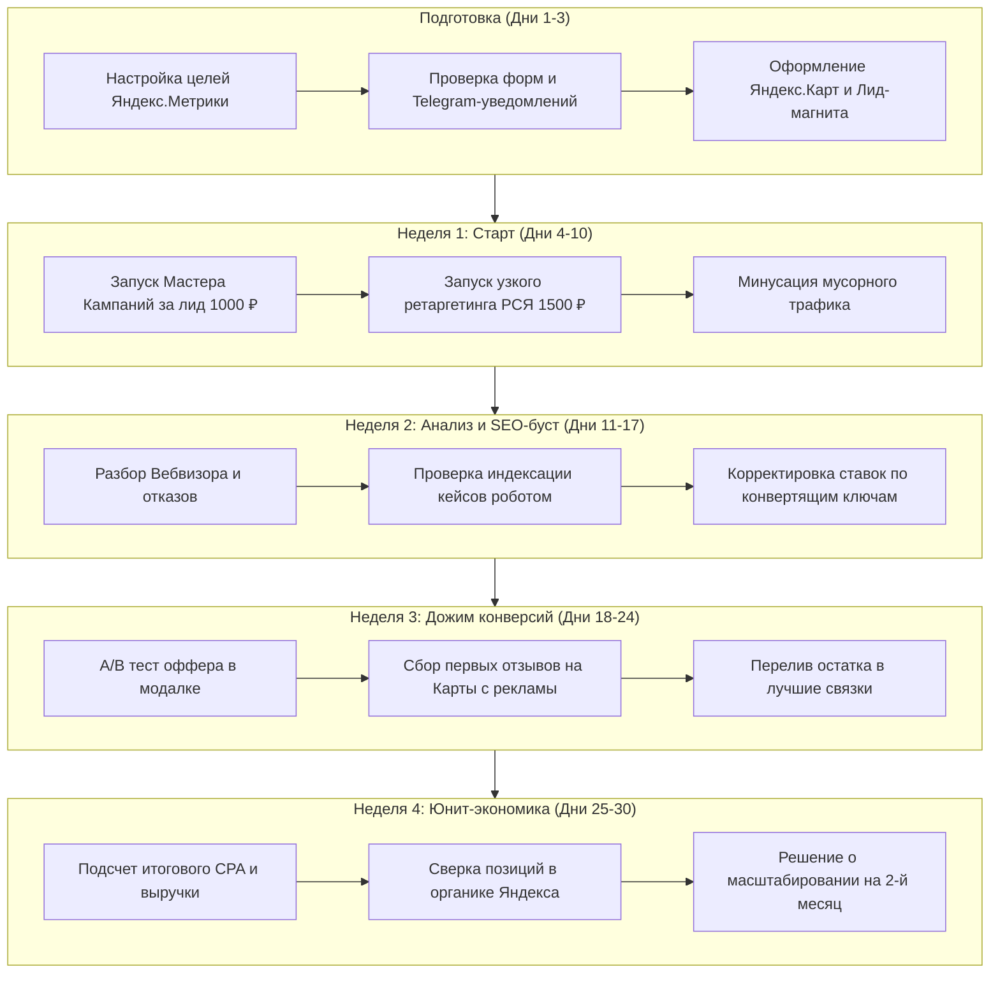

# Стратегия развития и тест связки «Директ + SEO» для VL Prime
## План пилотного запуска на 1 месяц (бюджет 10 000 ₽) с замером конверсии

---

### 1. Паспорт пилотного проекта

* **Объект:** Специализированный автосервис Volvo в Москве — **VL Prime** (`vlprime.ru`).
* **Тестовый период:** 30 календарных дней (4 недели).
* **Тестовый бюджет на рекламу:** **10 000 ₽** (без учета НДС / рекламный баланс кабинета).
* **Главная гипотеза теста:**
  > При микро-бюджете 10 000 ₽ в конкурентной Москве невозможно конкурировать «в лоб» на поиске по широким ключам («ремонт вольво»), однако **точечная связка «Мастер Кампаний с оплатой за целевой лид (CPA) + узкие посадочные страницы кейсов + смарт-ретаргетинг»** позволит привлечь **8–14 целевых обращений** по стоимости **700–1 250 ₽ за лид**, одновременно передав поведенческие факторы (время на сайте > 2 мин) страницам услуг для ускорения их выхода в ТОП органики Яндекса.

---

### 2. Целевые метрики и KPI пилота

| Показатель (Метрика) | Базовое значение (Старт) | Целевой показатель (1-й месяц) |
|---|---|---|
| **Расход бюджета** | 0 ₽ | 10 000 ₽ (строго лимитирован) |
| **Модель закупки трафика** | — | Оплата за конверсию (CPA) / Микро-клики |
| **Целевой CPA (цена заявки/звонка)** | — | **800 – 1 200 ₽** |
| **Количество лидов (заявки + звонки + мессенджеры)** | 0 | **8 – 14 целевых обращений** |
| **Конверсия сайта (CR в заявку)** | Текущая (~1-2%) | **4.5% – 7.5%** (за счет целевых страниц) |
| **Среднее время на странице (ПФ для SEO)** | < 1 мин | **> 2:15 мин** |
| **Конверсия из заявки в приезд в цех** | — | **55% – 70%** (5–9 обслуженных авто) |
| **Ожидаемый оборот с пилота** | — | **120 000 – 250 000 ₽** |

---

### 3. Понедельный план реализации (30 дней)



---

#### Этап 0. Подготовка инфраструктуры (Дни 1–3)
1. **Настройка сквозных целей в Яндекс.Метрике:**
   * `modal_booking_success` — успешная отправка формы записи через AJAX.
   * `click_phone_header_footer` — клик по номеру телефона с мобильных устройств.
   * `click_messenger_tg` / `click_messenger_wa` — прямой переход для диалога с мастером.
   * `deep_reading_case` — просмотр страницы кейса более 90 секунд и скролл 70%.
2. **Лид-магнит на сайте для тестового периода:**
   * Внедрить триггер на первом экране и в модальном окне:
     > *«Пилотная акция: Комплексный осмотр Volvo по 24 параметрам + диагностика подвески и муфты Haldex за 0 ₽ при любом ремонте или первом ТО»*.
3. **Оформление карточки на Яндекс.Картах (Яндекс.Бизнес):**
   * Актуализировать адрес, режим работы (09:00–21:00), загрузить фото ремзоны и оборудования (VIDA/DiCE).
   * Выгрузить прайс-лист на 15 ключевых услуг.

---

#### Этап 1. Запуск рекламы и первичный сбор данных (Дни 4–10)
1. **Кампания №1 (Основная): «Мастер Кампаний — Горячие боли Volvo» (Бюджет: 8 500 ₽)**
   * **Стратегия:** Максимум конверсий с фиксированной оплатой за достижение цели `modal_booking_success` или подтвержденный звонок.
   * **Цена цели:** 950 ₽. (Если система приводит пустые клики, баланс не списывается; оплата только за реальные лиды).
   * **Посадочные страницы:** 
     * [Кейс №4 (Муфта Haldex)](file:///D:/vl_prime/case-4.html)
     * [Кейс №5 (Угловая передача)](file:///D:/vl_prime/case-5.html)
     * [Кейс №6 (Масложор Drive-E)](file:///D:/vl_prime/case-6.html)
     * [Раздел услуг service.html](file:///D:/vl_prime/service.html)
2. **Кампания №2 (Вспомогательная): «Ретаргетинг на читателей кейсов» (Бюджет: 1 500 ₽)**
   * Показ графических баннеров в РСЯ тем, кто зашел на сайт, читал статьи блога, но ушел без заявки.
   * Текст объявления: *«Ищете надежный сервис для вашего Volvo? Прозрачная смета, оригинальный специнструмент, гарантия 12 месяцев. Запишитесь онлайн со скидкой 10%»*.

---

#### Этап 2. Контроль поведения и SEO-синхронизация (Дни 11–17)
1. **Аудит поведения через Яндекс.Вебвизор:**
   * Оценка тепловой карты кликов: нажимают ли пользователи на селектор моделей Volvo? Читают ли смету ремонта в кейсах?
   * Устранение барьеров (если посетители бросают форму — упростить поля до «Имя» и «Телефон»).
2. **Чистка поисковых запросов:**
   * Пополнение единого списка минус-слов (отсечение запросов «своими руками», «форум», «торрент vida dice», «бу запчасти разборка»).
3. **Проверка индексации и поведенческих факторов (SEO):**
   * Проверка через Яндекс.Вебмастер: фиксация времени на сайте у страниц кейсов. За счет платного трафика время визита вырастает до 2.5–3.5 минут, что ускоряет попадание страниц в ТОП-10 органической выдачи.

---

#### Этап 3. Тюнинг конверсии и сбор отзывов (Дни 18–24)
1. **Перераспределение рекламного веса:**
   * Выявление самого дешевого и маржинального направления (например, если обращения по замене ремня ГРМ и мойке радиаторов обходятся по 750 ₽, а по масложору — по 1 300 ₽, масштабируем связку по ГРМ и радиаторам).
2. **Запуск цикла «Первый клиент ➔ Отзыв на Карты»:**
   * Каждому клиенту, приехавшему по рекламе на тестовой неделе, отправляется персональное сообщение от мастера с просьбой поставить оценку на Яндекс.Картах (увеличение локального рейтинга).

---

#### Этап 4. Итоговая аналитика, юнит-экономика и выводы (Дни 25–30)
1. Сведение сводной таблицы эффективности за 30 дней.
2. Расчет окупаемости инвестиций в маркетинг (ROMI).
3. Анализ позиций в поисковых системах по продвигаемым LSI-запросам без рекламы.
4. Принятие решения: масштабирование бюджета до 20 000–35 000 ₽ или корректировка офферов.

---

### 4. Семантическое ядро пилотной кампании

#### Приоритетные кластеры (Только узкие боли и узлы):

```
Группа 1: Трансмиссия и полный привод
├── ремонт муфты haldex вольво москва
├── замена масла халдекс volvo xc60 xc90
├── срезало шлицы втулки угловой передачи вольво
└── замена втулки углового редуктора volvo xc90

Группа 2: Двигатель и ГРМ
├── замена ремня грм вольво d4 d5 цена
├── регламент замены грм volvo drive e
├── чистка клапанов скорлупой грецкого ореха вольво
└── устранение масложора volvo drive e москва

Группа 3: Охлаждение и сезонные работы
├── мойка радиаторов со снятием вольво хс90
├── чистка бутерброда радиаторов volvo xc60
└── перегрев акпп volvo промывка радиаторов

Группа 4: Регламентное обслуживание
├── профильное то volvo москва цены
├── диагностика volvo vida dice специализированный сервис
└── замена масла акпп aisin volvo xc70
```

#### Единый список минус-слов (Защита от нецелевого расхода):
> `-бу`, `-разборка`, `-авито`, `-своими`, `-руками`, `-скачать`, `-видео`, `-ютуб`, `-отзывы`, `-книга`, `-инструкция`, `-бесплатно`, `-торрент`, `-ваз`, `-форд`, `-китайские`

---

### 5. Модель расчета юнит-экономики теста (10 000 ₽)

| Параметр | Пессимистичный | Реалистичный (Базовый) | Оптимистичный |
|---|---|---|---|
| **Рекламный бюджет** | 10 000 ₽ | 10 000 ₽ | 10 000 ₽ |
| **Количество переходов на сайт** | 120 | 180 | 230 |
| **Конверсия сайта в обращение (CR)** | 4.0% | **6.5%** | 8.5% |
| **Количество лидов (заявок/звонков)** | **5 лидов** | **11 лидов** | **18 лидов** |
| **Средняя цена лида (CPA)** | 2 000 ₽ | **909 ₽** | **555 ₽** |
| **Конверсия из лида в доезд в сервис** | 50% | **65%** | 75% |
| **Количество обслуженных авто** | 2-3 авто | **7 авто** | 13 авто |
| **Средний чек заказа-наряда** | 18 000 ₽ | **28 000 ₽** | 35 000 ₽ |
| **Валовая выручка цеха** | 45 000 ₽ | **196 000 ₽** | 455 000 ₽ |
| **Маржинальность услуг (работа + запчасти)** | 45% | **50%** | 50% |
| **Валовая прибыль** | 20 250 ₽ | **98 000 ₽** | 227 500 ₽ |
| **Чистый финансовый итог пилота (ROI рекламы)** | **+10 250 ₽ (+102%)** | **+88 000 ₽ (+880%)** | **+217 500 ₽ (+2175%)** |

---

### 6. Шаблон отчетности по конверсиям (Для заполнения в ходе теста)

| Дата | Расход (₽) | Показы / Клики | Заявки (сайт) | Звонки / Мессенджеры | Всего лидов | Приехало авто | Сумма заказ-нарядов (₽) |
|---|---|---|---|---|---|---|---|
| **Неделя 1** | | | | | | | |
| **Неделя 2** | | | | | | | |
| **Неделя 3** | | | | | | | |
| **Неделя 4** | | | | | | | |
| **ИТОГО** | **10 000 ₽** | | | | | | |

---

### 7. Критерии перехода к постоянной стратегии

Пилотный тест считается **успешным**, если по итогам 30 дней:
1. Средняя стоимость подтвержденного обращения составила **менее 1 300 ₽**.
2. Доезд в сервис составил не менее **50%** от обратившихся.
3. Рекламный бюджет полностью окупился за счет маржи с выполненных заказ-нарядов.
4. Зафиксирован рост глубины просмотра и начался рост органических показов страниц кейсов в Яндекс.Вебмастере.
